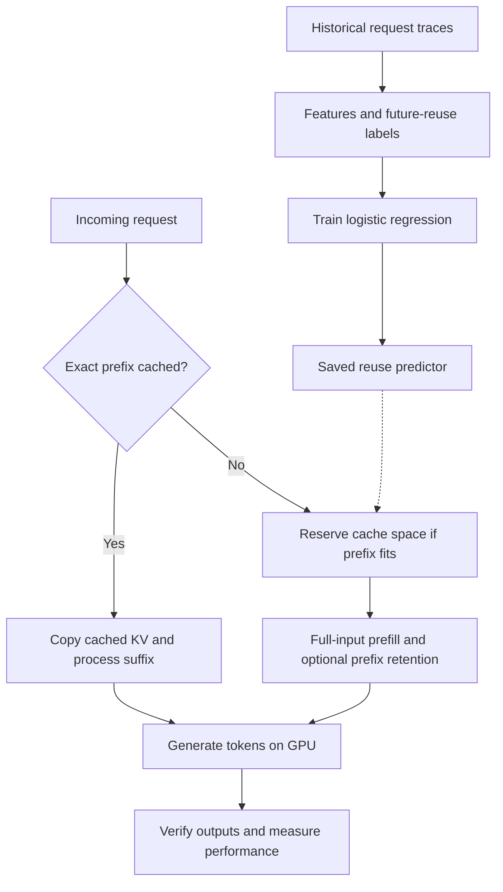

# Learning-Based KV-Cache Management for GPU LLM Inference

A research prototype that trains a small reuse predictor and evaluates whether
learned prefix-cache eviction improves LLM inference under a fixed memory budget.
Built with Python, NumPy, PyTorch, and Hugging Face Transformers.

**Current result:** the extended NVIDIA T4 float32 experiment completed **90 runs /
13,500 request executions**, with matching generated outputs across all strategies
within each workload/budget comparison. Learned eviction improved reuse over LRU
in some cases, but **did not demonstrate a latency or throughput advantage**.
Profiling identifies KV copying as a larger measured cost than predictor execution.
Reducing that copying safely is the next optimization; it is not implemented yet.

## How it works



The predictor estimates reuse within the next **32 requests** using recency,
cumulative frequency, prefix length, and mean historical interarrival gap.
Log-transformed features are normalized using training data only. Future accesses
are used for labels, never features; the incomplete label horizon at the end of
each training trace is excluded.

Five strategies are compared: **no cache, FIFO, LRU, LFU, and learned eviction**.
The learned strategy evicts entries with the lowest
`P(reuse) × prefix_tokens / retained_bytes` first. This is a heuristic value score,
not an optimal policy or a measured FLOP estimate. With a fixed full-attention
model, bytes scale with prefix length, so that ratio largely cancels.

The cache retains independent whole prefixes. Matching is exact, not semantic.
Requests run sequentially, and active generation uses separate KV state. Cache
misses use full-input prefill; the retained prefix is copied and cropped afterward.
Hits copy retained KV before extending it, preserving the original cached state.
The budget covers retained KV only—not model weights, active KV, temporary copies,
inputs, or allocator overhead.

## Measured NVIDIA GPU results

The extended experiment used **SmolLM2-135M, NVIDIA T4, float32**, 150 requests per
run, four generated tokens per request, three timing repeats, three workloads,
and 8/32 MiB cache budgets. All six groups completed and passed strict generated-
token equality against the no-cache reference. Workload seed 99 was held out from
training; repeats are timing trials, not independent workload samples.

Selected **32 MiB** results:

| Workload | LRU hit rate | Learned hit rate | LRU median run-p95 TTFT | Learned median run-p95 TTFT |
|---|---:|---:|---:|---:|
| Hot prefixes | 50.0% | 55.3% | 63.25 ms | 65.19 ms |
| Popularity shift | 49.3% | 50.0% | 60.62 ms | 66.14 ms |
| Sequential scan | 0% | 0% | 61.29 ms | 71.16 ms |

TTFT means time to first token. Each timing above is the **median of three per-run
p95 values**, not a pooled p95. The learned policy tied LFU's 83/150 hits on hot
traffic at 32 MiB. Better reuse alone did not translate into faster inference.

[Original ZIPs, per-run reports, checksums, and full results summary](benchmarks/colab-2026-10-13/README.md)

### Profiling findings

A separate NVIDIA T4 float32 diagnostic replayed 60 hot-prefix requests per
strategy, once, with a 32 MiB budget. All strategies passed output checks.
For the learned policy:

| Stage | Invocations | Mean per invocation | Total |
|---|---:|---:|---:|
| Features + prediction | 13 | 0.18 ms | 2.30 ms |
| Copy KV on a cache hit | 28 | 5.15 ms | 144.09 ms |
| Copy and retain a new prefix | 32 | 6.06 ms | 193.98 ms |

Prediction is nested within eviction-decision timing and must not be counted
twice. Copying cost substantially more than prediction in this diagnostic.
This motivates optimizing copies; it does not establish that copying explains
every latency difference. The learned strategy had 28/60 hits versus LRU's 29/60.

Stage profiling synchronizes the GPU and includes host/framework overhead. It
changes execution timing and is **not a replacement for uninstrumented performance
benchmarks**. Hit/miss requests can have different prefix lengths, so their mean
prefill times are not a matched estimate of computation saved.

[Profiling evidence and provenance](benchmarks/colab-2026-10-14-profile/README.md)

## Run in Colab without paid APIs or Drive storage

Select an available NVIDIA T4 runtime. Free GPU availability is not guaranteed.
Choose the notebook appropriate to the experiment:

| Notebook | Purpose |
|---|---|
| [Short correctness check](https://colab.research.google.com/github/swathiblrs/Learning-Based-KV-Cache-Management-for-GPU-LLM-Inference/blob/main/notebooks/gpu_experiment.ipynb) | 30 requests per strategy, one float32 repeat |
| [One benchmark group at a time](https://colab.research.google.com/github/swathiblrs/Learning-Based-KV-Cache-Management-for-GPU-LLM-Inference/blob/main/notebooks/gpu_benchmark_groups.ipynb) | Choose one of six groups; download its ZIP before leaving |
| [Full benchmark suite](https://colab.research.google.com/github/swathiblrs/Learning-Based-KV-Cache-Management-for-GPU-LLM-Inference/blob/main/notebooks/gpu_benchmark_suite.ipynb) | All 90 runs; substantially longer session |
| [Short stage profile](https://colab.research.google.com/github/swathiblrs/Learning-Based-KV-Cache-Management-for-GPU-LLM-Inference/blob/main/notebooks/gpu_profile.ipynb) | Diagnose prediction, copying, prefill, and decode costs |

The notebooks isolate inference dependencies, verify CUDA availability, and run
tests before experiments. Benchmark reports checkpoint after completed policies;
notebooks archive diagnostics on ordinary failures. A terminated Colab runtime
can still lose temporary files. **Confirm the ZIP is downloaded to your laptop
before closing the session.** No Drive mount is required.

## Local setup and simulation

Use Python 3.10+; macOS system Python may be too old.

```bash
python3 -m venv .venv
source .venv/bin/activate
python -m pip install -e .
kv-cache experiment --output results/experiment
python -m unittest discover -s tests -v
```

The default simulator trains on seed 42, validates on 43, and tests seeds 44–46
across three workloads and two budgets. It saves JSONL traces, predictor parameters,
precision/recall at threshold 0.5, prevalence, Brier score, and cache metrics.
Simulation reuse counts are not GPU latency or throughput measurements.

Install inference dependencies to run all **21 tests**, including tiny-model
correctness and profiling regressions (otherwise inference tests are skipped):

```bash
python -m pip install -e '.[inference]'
python -m unittest discover -s tests -v
kv-cache benchmark --predictor results/experiment/predictor.json \
  --tiny --device cpu --dtype float32 --requests 30 --new-tokens 3 \
  --repeats 1 --budget-mib 0.05 --output results/cpu-correctness.json
```

`--tiny` uses randomly initialized Llama weights without a model download. It
validates execution, not pretrained-model quality or representative performance.

## GPU commands

A short pretrained-model check (first run downloads weights):

```bash
kv-cache benchmark --predictor results/experiment/predictor.json \
  --device cuda --dtype float32 --model HuggingFaceTB/SmolLM2-135M \
  --requests 30 --budget-mib 4 --new-tokens 8 --repeats 1 \
  --output results/gpu-fp32-check.json
```

Full suite; the output directory must be new:

```bash
python -m kv_cache.suite --output results/gpu-suite --device cuda
```

One group only, using the same protocol:

```bash
python -m kv_cache.suite --output results/hot-32-run1 --device cuda \
  --workloads hot --budgets 32 --requests 150 --repeats 3
```

Diagnostic profiling with the frozen initial predictor:

```bash
kv-cache benchmark --predictor docs/validation/predictor.json --device cuda \
  --dtype float32 --workload hot --requests 60 --budget-mib 32 \
  --new-tokens 4 --repeats 1 --profile-stages --output results/profile.json
```

Reports record hardware, versions, dtype, input/predictor hashes, generated tokens,
hit flags, memory, and timings. Policy order is shuffled and each run warms up
before timing. A correctness failure exits with an error and preserves diagnostics.
See [measurement boundaries and methodology](docs/EXPERIMENTS.md).

## Correctness investigation and limits

The initial FP16 run produced consistent but different output hashes for cached
versus uncached paths. Miss processing was changed from separate prefix/suffix
calls to one full-input call, and per-request diagnostics were added. Subsequent
float32 runs passed. **The original FP16 root cause remains unconfirmed, and FP16
correctness is not established.** Neither tolerances nor output checks were relaxed.
The [failed FP16 report](benchmarks/colab-2026-10-13/initial-fp16/reports/gpu.json)
remains preserved alongside passing results.

This is a sequential research harness, not a production inference server:

- Synthetic token IDs and traces do not measure real answer quality or production generalization.
- No continuous batching, partial-prefix matching, paged attention, custom CUDA kernels, or multi-GPU execution.
- Metadata grows with unique prefixes; learned eviction scans resident candidates.
- Fixed output lengths ignore EOS for comparable work and differ from real traffic.
- GPU performance conclusions apply only to the measured model, precision, workloads, and environment.

## Next work

1. Reduce unnecessary KV copying while preserving immutable retained state.
2. Test output equivalence and exact cache-budget accounting after changes.
3. Re-run uninstrumented comparisons before claiming a performance improvement.
4. Extend evaluation to independent workload seeds, real traces, and feature ablations.

## Repository map

- `src/kv_cache/`: traces, predictor, cache policies, simulator, inference, profiling, and suite runner.
- `tests/`: policy, leakage, inference-equivalence, profiling, and failure-archive checks.
- `notebooks/`: Colab workflows.
- `benchmarks/`: original downloaded GPU artifacts and summaries.
- `docs/validation/`: initial simulation and CPU validation evidence.

## References

- [Hugging Face KV-cache documentation](https://huggingface.co/docs/transformers/en/kv_cache)
- [vLLM automatic prefix caching](https://docs.vllm.ai/en/stable/features/automatic_prefix_caching/)
- [SGLang / RadixAttention](https://lmsys.org/blog/2024-01-17-sglang/)

The project evaluates a simplified learned policy; it does not claim to invent
prefix caching or learned eviction.

## Local inference service (new)

The project now includes a persistent FastAPI token-inference service, bounded request admission, Prometheus metrics, provisioned Grafana dashboard, Docker Compose configuration, and a restart-isolated HTTP evaluation runner. The experimental sliced-prefix retention copy is compared against the original copy path; no GPU speedup is claimed.

See [serving instructions and limitations](docs/serving.md). Use [the GPU serving notebook](notebooks/gpu_serving.ipynb) which downloads the project directly from GitHub and needs no Google Drive storage. An optional offline source bundle can be built with `python scripts/package_serving.py`. The first GPU HTTP smoke check passed all 150 output-equivalence checks; see [results and limitations](benchmarks/colab-2026-10-19-serving/README.md). Next run the [concurrency-4 notebook](notebooks/gpu_serving_concurrency.ipynb). Existing offline GPU results are separate from serving results.
